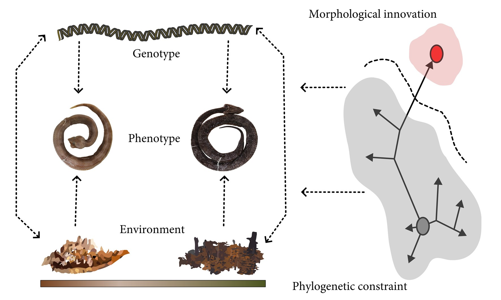

# Phylogeny structures morphological head disparity in Neotropical Hognose Pitvipers (*Porthidium*)

This repository contains the data and code supporting the publication.

---

## Overview

  

---

## Data and Code Availability

All datasets, raw measurements, phylogenetic trees, and analytical scripts used in this study **are fully available** in this repository to ensure complete reproducibility:

* **`/data`**: Contains raw morphological landmark coordinates, phenotypic matrices, and phylogenetic trees in standard formats (`.csv`, `.rds`, `.tre`).
* **`/codes`**: Contains reproducible scripts for geometric morphometrics, phylogenetic comparative methods, and statistical modeling.
